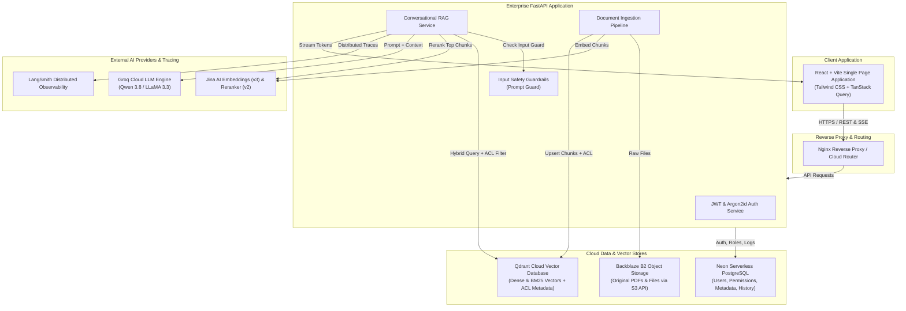

Deploy Link:https://enterprise-rag-assistant-omega.vercel.app

# Enterprise RAG Assistant

[](https://fastapi.tiangolo.com)
[](https://react.dev)
[](https://www.typescriptlang.org)
[](https://www.docker.com)
[](https://qdrant.tech)
[](https://smith.langchain.com)

A role-aware, multi-department Enterprise Retrieval-Augmented Generation (RAG) platform. It provides employees with verified, strictly grounded answers from authorized company documentation, guarantees provenance with inline citation markers, enforces role-based access control (RBAC/ACL) at the vector layer, actively suppresses hallucinations, and tracks all inferences through distributed LangSmith tracing.

---

## Table of Contents

- [Problem Statement](#problem-statement)
- [The Solution](#the-solution)
- [Key Features](#key-features)
- [System Architecture](#system-architecture)
- [Tech Stack](#tech-stack)
- [Project Structure](#project-structure)
- [Setup & Installation Guide](#setup--installation-guide)
  - [Prerequisites](#prerequisites)
  - [Environment Configuration](#environment-configuration)
  - [Option A: Local Development](#option-a-local-development)
  - [Option B: Run with Docker Compose](#option-b-run-with-docker-compose)
  - [Option C: Production Cloud Deployment](#option-c-production-cloud-deployment)
- [Default Seed Accounts](#default-seed-accounts)
- [License](#license)

---

## Problem Statement

Modern enterprises face significant hurdles when adopting Large Language Models internally:

1. **Information Silos & Unauthorized Exposure:** Sensitive documents (compensation structures, internal audit reports, IT security policies) are scattered across departments. Standard RAG architectures lack granular Access Control Lists (ACLs), risking information leakage to unauthorized employees.
2. **Hallucinations & Ungrounded Claims:** Off-the-shelf generative AI frequently invents facts or blends contradictory company policies without verifiable provenance, leading to compliance failures and incorrect business decisions.
3. **Stale Documentation & Version Drift:** As policies evolve (e.g., VPN guides, HR benefits), outdated document versions persist in vector indices, resulting in employees acting on superseded guidelines.
4. **Lack of Operational Visibility:** Enterprise teams deploy generative models without token-level tracing, guardrails monitoring, latency profiling, or cost accounting, making it impossible to evaluate safety, security injections, or pipeline regressions.

---

## The Solution

**Enterprise RAG Assistant** addresses these challenges through a secure, modular, role-aware architecture:

- **Vector-Level ACL Filtering:** Every document and chunk is tagged with departmental scope (`company`, `engineering`, `hr`, `finance`) and minimum clearance tiers (`employee`, `manager`, `admin`). Vector searches apply strict cryptographic pre-filtering so unauthorized documents are never presented to the model.
- **Hybrid Search & Cross-Encoder Reranking:** Combines semantic dense vectors (`jina-embeddings-v3`, 1024-dim) with lexical sparse vectors (BM25 via Qdrant) and cross-encoder reranking (`jina-reranker-v2-base-multilingual`) to achieve top retrieval precision.
- **Strict Grounding & Anti-Hallucination Prompting:** The LLM is constrained to answer strictly from the retrieved context. When context is missing or ambiguous, it reliably states: *"I could not find sufficient information in the verified company documentation."*
- **Automatic Version Management:** Uploading a newer version of an existing policy automatically archives and de-indexes older revisions from the vector database, preventing version drift.
- **End-to-End Observability:** Powered by LangSmith distributed tracing, capturing prompt safety scores, latency (TTFT), retrieval recall, and token usage per turn.

---

## Key Features

### 1. Role-Aware Access Control & Security
- **Departmental Boundaries:** Supports company-wide visibility alongside department-restricted scopes (`HR`, `Engineering`, `Finance`).
- **Granular Clearance Roles:** Multi-tiered clearance (`Employee`, `Manager`, `Admin`).
- **Dual-Layer Guardrails:** Real-time prompt-injection defense with Meta Prompt Guard (`meta-llama/llama-prompt-guard-2-86m`) and output safety verification via Safeguard LLM.

### 2. High-Precision Retrieval & Grounding
- **Hybrid Search:** Combines dense semantic representations with BM25 sparse keyword matching.
- **Cross-Encoder Reranking:** Re-scores top-k candidates to isolate the most relevant contextual passages.
- **Exact Citation Provenance:** Every response includes interactive citation tags (e.g., `[1]`, `[2]`) linked to source document titles, versions, and page excerpts.

### 3. Multi-Turn Conversational Memory
- **Contextual Query Rewriting:** Maintains conversation history across turns, resolving coreferences and pronouns (e.g., "What is the emergency extension for it?").
- **Streaming Responses:** Real-time token streaming via Server-Sent Events (SSE) with smooth UI markdown rendering.

### 4. Admin Management & Live Diagnostics
- **Document Ingestion Engine:** Direct drag-and-drop file upload for PDF, DOCX, TXT, and Markdown files with automatic chunking, embedding, and vector upserting.
- **Version Lifecycle Controls:** Instant document status updates (Active, Inactive, Archived) with automatic vector store index synchronization.
- **Live System Diagnostics:** Real-time connectivity and status dashboard covering PostgreSQL (Neon), Qdrant Cloud, Jina Embeddings, Groq Cloud, Object Storage (Backblaze B2), and LangSmith.

---

## System Architecture

### High-Level Architecture & Request Flow



### Document Ingestion & Lifecycle Pipeline

```mermaid
flowchart LR
    Upload["Upload File<br/>(PDF, DOCX, TXT)"] --> Parse["Extract Text & Metadata<br/>(PyMuPDF / docx)"]
    Parse --> Chunk["Hierarchical Chunking<br/>(LangChain Text Splitters)"]
    Chunk --> Embed["Generate Embeddings<br/>(Jina Embeddings v3)"]
    Embed --> Index["Upsert Vectors + ACL Metadata<br/>(Qdrant Cloud)"]
    Index --> Storage["Save Original File<br/>(Backblaze B2 / Local)"]
    Storage --> DB["Store Document & Chunk Records<br/>(Neon PostgreSQL)"]
    DB --> VersionSync["Auto-Archive Prior Revisions<br/>(Sync Vector Index)"]
```



---

## Tech Stack

| Layer | Technologies & Tools |
| :--- | :--- |
| **Frontend** | React 18, TypeScript, Vite, Tailwind CSS, TanStack React Query, React Router v6, Sonner, Lucide React, React Markdown |
| **Backend** | Python 3.11, FastAPI, Uvicorn (ASGI), Pydantic v2, Pydantic Settings, SlowAPI Rate Limiting |
| **Database & ORM** | Neon Serverless PostgreSQL, SQLAlchemy 2.0, Alembic Migrations, Psycopg3 |
| **Vector Search** | Qdrant Cloud (Managed Vector Engine), FastEmbed (Sparse BM25 Indexing) |
| **Embeddings & Reranking** | Jina AI `jina-embeddings-v3` (1024-dim), `jina-reranker-v2-base-multilingual` |
| **Generative LLM** | Groq Cloud (`qwen/qwen3.8-27b`, `llama-3.3-70b-versatile`) |
| **Guardrails & Safety** | Meta Prompt Guard (`meta-llama/llama-prompt-guard-2-86m`), Safeguard LLM |
| **Observability** | LangSmith (Distributed tracing, latency tracking, token usage, guardrail metrics) |
| **Storage** | Backblaze B2 Object Storage (AWS S3-compatible API), Local fallback |
| **Container & Cloud** | Docker, Docker Compose, Nginx Alpine, Render, Vercel |

---

## Project Structure

```text
Enterprise-rag/
├── backend/
│   ├── src/
│   │   └── app/
│   │       ├── api/v1/         # REST API routes (auth, chat, admin, documents)
│   │       ├── core/           # Configuration, security, database sessions, logging
│   │       ├── db/             # SQLAlchemy ORM models & database schemas
│   │       ├── generation/     # Prompt templates, answer generation, guardrails
│   │       ├── ingestion/      # Document parsing, chunking, and embedding pipeline
│   │       ├── providers/      # Storage (B2/Local), vector store (Qdrant), LLM (Groq)
│   │       ├── retrieval/      # Hybrid search, vector filtering, and cross-encoder rerank
│   │       ├── services/       # Chat orchestration and session managers
│   │       └── main.py         # FastAPI application entrypoint & middleware
│   ├── migrations/             # Alembic database migrations
│   ├── Dockerfile              # Backend containerization file
│   └── requirements.txt        # Python production dependencies
├── frontend/
│   ├── src/
│   │   ├── features/           # Modular feature views (auth, chat, admin dashboard)
│   │   ├── lib/                # API client, SSE streaming reader, auth tokens
│   │   ├── routes/             # Client-side React Router configuration
│   │   └── App.tsx             # Root layout and theme providers
│   ├── nginx.conf              # Production Nginx reverse-proxy configuration
│   ├── Dockerfile              # Frontend multi-stage build containerization file
│   └── package.json            # Node dependencies and build scripts
├── docker-compose.yml          # Multi-container orchestration (Backend + Frontend)
├── render.yaml                 # Infrastructure-as-Code for Render Cloud deployment
└── README.md                   # Project documentation
```

---

## Setup & Installation Guide

### Prerequisites

- **Python 3.11+** installed
- **Node.js 20+** and `npm` installed
- **Docker & Docker Compose** (optional, for containerized run)
- Cloud credentials for:
  - [Neon PostgreSQL](https://neon.tech)
  - [Qdrant Cloud](https://cloud.qdrant.io)
  - [Groq Cloud](https://console.groq.com)
  - [Jina AI](https://jina.ai)
  - [LangSmith](https://smith.langchain.com) *(optional for observability)*
  - [Backblaze B2](https://www.backblaze.com) *(optional for object storage)*

---

### Environment Configuration

Create a `.env` file in the project root:

```env
# Application
APP_ENV=local
LOG_LEVEL=INFO
CORS_ORIGINS=http://localhost:5173,http://localhost:80

# Authentication
JWT_SECRET_KEY=change-to-a-secure-random-32-character-secret-key
JWT_ALGORITHM=HS256
ACCESS_TOKEN_MINUTES=30
REFRESH_TOKEN_DAYS=7

# Neon Serverless PostgreSQL
DATABASE_URL=postgresql://<user>:<password>@<host>/<database>?sslmode=require
DATABASE_URL_DIRECT=postgresql://<user>:<password>@<direct-host>/<database>?sslmode=require

# Qdrant Vector Cloud
QDRANT_URL=https://<your-cluster-id>.aws.cloud.qdrant.io
QDRANT_API_KEY=<your-qdrant-api-key>
QDRANT_COLLECTION=enterprise_docs

# AI & Embedding Providers
JINA_API_KEY=<your-jina-api-key>
EMBEDDING_MODEL=jina-embeddings-v3
EMBEDDING_DIM=1024
RERANKER_MODEL=jina-reranker-v2-base-multilingual
SPARSE_MODEL=Qdrant/bm25

# Groq LLM
GROQ_API_KEY=<your-groq-api-key>
GROQ_MODEL=qwen/qwen3.8-27b
GUARD_MODEL_NAME=openai/gpt-oss-safeguard-20b
PROMPT_GUARD_MODEL=meta-llama/llama-prompt-guard-2-86m
ENABLE_GUARDRAILS=true

# Storage (Backblaze B2 or local)
STORAGE_BACKEND=b2
B2_KEY_ID=<your-b2-key-id>
B2_APPLICATION_KEY=<your-b2-app-key>
B2_BUCKET_NAME=<your-b2-bucket-name>
B2_ENDPOINT_URL=https://s3.us-east-005.backblazeb2.com

# LangSmith Observability
LANGSMITH_TRACING=true
LANGSMITH_ENDPOINT=https://api.smith.langchain.com
LANGSMITH_API_KEY=<your-langsmith-api-key>
LANGSMITH_PROJECT=tracy-development
LANGSMITH_AGENT_ID=tracy
LANGSMITH_AGENT_ENVIRONMENT=local
```

## Default Seed Accounts

When running `python -m app.cli seed`, the following default test accounts are initialized:

| Role | Email | Password | Department | Access Clearance |
| :--- | :--- | :--- | :--- | :--- |
| **System Admin** | `admin@company.com` | `admin123` | Management | Full platform access, all documents, ingestion & settings |
| **HR Manager** | `hr.manager@company.com` | `manager123` | Human Resources | Company-wide + HR department documents |
| **Engineering Employee** | `eng.user@company.com` | `user123` | Engineering | Company-wide + Engineering documents |
| **General Employee** | `employee@company.com` | `user123` | Operations | Company-wide documents only |

---

## License

This project is licensed under the MIT License - see the [LICENSE](LICENSE) file for details.

